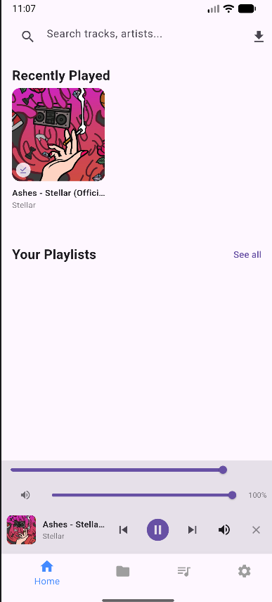
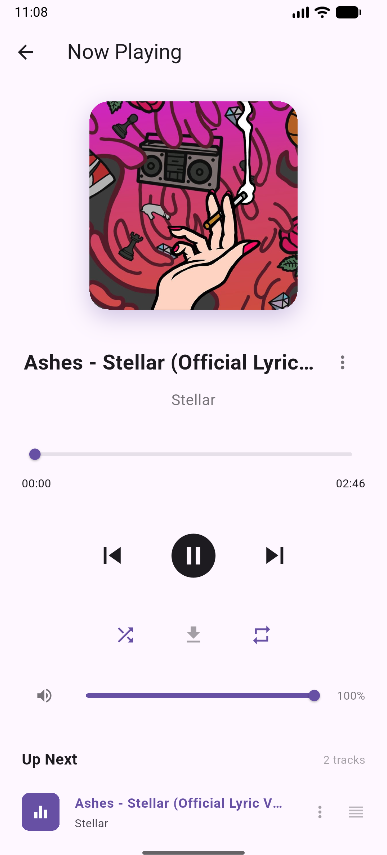
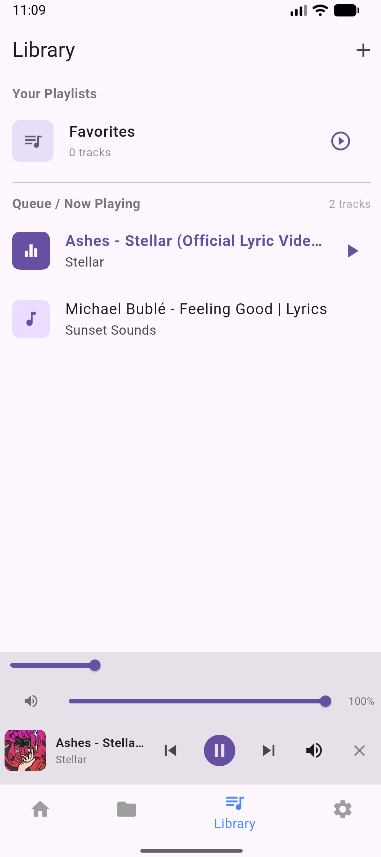
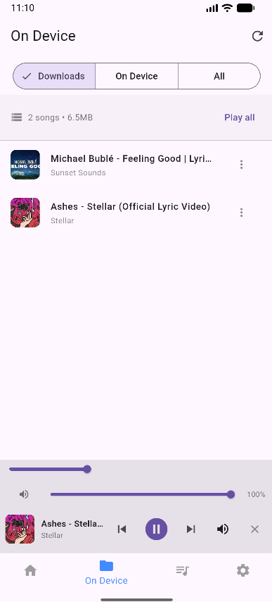
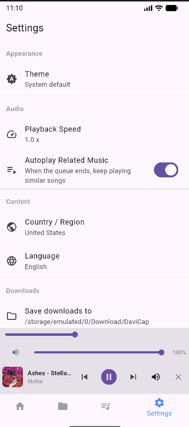

# CSE101 Final Project Documentation

## Project Title
**Musicap — Music Player**

## Project Category
Android App — Project #16

---

## Project Description

Musicap is a Flutter-based music player application for Android that allows users to browse music by genres and moods, search for songs with live suggestions, create and manage playlists, download tracks for offline playback, and enjoy full audio playback controls including background audio support. The app features a clean, modern Material 3 design with both dark and light themes, responsive layouts, and a persistent mini player for seamless music listening across all screens.

---

## Features

### Core Features
- **Music Search** — Search for songs with real-time auto-suggestions and recent search history
- **Genre & Mood Browsing** — Browse music categories displayed in a responsive color-coded grid layout
- **Now Playing Screen** — Full-screen player with album art, seek bar, elapsed/total time, and playback controls
- **Mini Player** — Persistent docked player bar visible across all screens for uninterrupted playback
- **Playback Controls** — Play, pause, skip previous/next, shuffle, repeat (off/all/one), volume slider, and playback speed adjustment

### Playlist Management
- **Create Playlists** — Users can create custom playlists with a name input dialog and form validation
- **Rename & Delete Playlists** — Edit or remove playlists through intuitive dialog prompts
- **Add/Remove Tracks** — Add songs to playlists from any track listing, remove individual tracks from playlist detail view
- **Queue Management** — Drag-and-drop reorderable playback queue in the Now Playing screen

### Downloads & Offline Playback
- **Download Tracks** — Download songs as .mp3 files with real-time byte-progress tracking
- **Downloads Library** — View all downloaded tracks with storage usage info (count and total size in MB)
- **Offline Playback** — Play downloaded songs without an internet connection
- **Swipe to Delete** — Remove downloaded tracks with swipe gesture

### On-Device Music
- **Local Audio Scanner** — Scans device storage for existing music files via Android MediaStore
- **Unified Library** — View downloads and on-device music together with segmented filter controls (Downloads / On Device / All)
- **Permission Handling** — Requests audio and storage permissions at runtime

### Dashboard & Discovery
- **Trending Charts** — View trending and popular music charts
- **Recently Played** — Quick access to recently played tracks
- **Made For You** — Personalized music recommendations
- **Genre Quick-Pick Chips** — Tap genre chips on the home screen for instant genre browsing

### Settings & Configuration
- **Theme Mode** — Switch between Light, Dark, and System theme
- **Playback Speed** — Adjustable playback speed
- **Autoplay** — Toggle autoplay for related tracks
- **Region & Language** — Configurable content region and language preferences
- **Download Directory** — Choose custom folder for downloaded files
- **Backend Server URL** — Configurable server endpoint with health check ping

### UI & Design
- **Material 3 Design** — Modern Material Design 3 with dynamic theming
- **Responsive Layout** — Genre grid adapts columns based on screen width (2 columns on phone, 3 on tablet, 4 on desktop)
- **Background Audio** — Music continues playing with lock screen and notification tray controls
- **Smooth Navigation** — Bottom navigation bar with tab state preservation, named routes, and modal sheets

---

## App Screens

### 1. Home Screen (Dashboard / Search)
The main landing screen features a search bar in the AppBar with live auto-suggestions. Below it, the dashboard displays genre quick-pick chips, Recently Played tracks, Made For You recommendations, Trending Charts, and Your Playlists sections arranged in scrollable horizontal rows.



### 2. Now Playing / Player Screen (Details Screen)
A full-screen player displaying large album art, track title and artist name, an interactive seek bar with elapsed and total time labels, and playback controls including previous, play/pause, next, shuffle toggle, loop mode toggle, volume slider with mute, and a download button with progress indicator. Below the controls is a reorderable Up Next queue.



### 3. Playlist Library & Create Playlist (Form / Input Screen)
The library screen lists all user-created playlists with track counts and quick-play buttons. The "+" button in the AppBar opens a Create Playlist dialog with a text input form and validation — empty names show an error message and are not accepted. Playlists can also be renamed or deleted through similar dialog prompts.



### 4. Downloads Page (Summary / Result Screen)
Shows all downloaded tracks with a storage info bar displaying the total download count and size in megabytes. Includes a Play All button, sort options (by date, name, or artist), and swipe-to-delete functionality for managing offline tracks.



### 5. Settings Page
A comprehensive settings screen organized in sections: Appearance (theme mode), Audio (playback speed, autoplay toggle), Content (country/region, language), Server (backend URL with ping test), Downloads (directory picker, clear all), and About dialog with app info.



---

## Technologies & Tools Used

| Technology | Purpose |
|---|---|
| Flutter (Dart) | Cross-platform mobile app framework |
| Material 3 | UI design system |
| Riverpod | State management |
| just_audio | Audio playback engine |
| audio_service | Background audio & notification controls |
| Dio | HTTP client for API calls and file downloads |
| SharedPreferences | Local key-value data persistence |
| path_provider | Device filesystem access |
| file_picker | Download directory selection |
| permission_handler | Runtime permission requests |
| url_launcher | Opening external links |

---

## Data Handling

All app data is managed using local data structures:
- **Playlists** — Stored as `List<Playlist>` with each playlist containing a `List<Track>`, managed by a Riverpod StateNotifier and persisted locally via SharedPreferences as JSON
- **Downloads** — Tracked as `Map<String, DownloadState>` with file references to locally saved .mp3 and .jpg files
- **Recent Searches** — Maintained as a `List<String>` capped at 10 entries
- **Settings** — Individual key-value pairs for theme, speed, region, language, and other preferences
- **Playback Queue & Recently Played** — In-memory `List<Track>` managed by the audio player controller

No database technologies (SQLite, Hive, Firebase, Firestore, Supabase, or MySQL) are used in this project.

---

## Project Structure

```
music_player/
├── lib/
│   ├── main.dart                          # App entry, MainScreen, HomePage, SettingsPage
│   ├── audio_handler.dart                 # Background audio notification handler
│   ├── features/
│   │   ├── device/
│   │   │   └── device_music_page.dart     # On-device local music scanner
│   │   ├── downloads/
│   │   │   ├── downloads_page.dart        # Downloaded tracks library
│   │   │   └── download_art_*.dart        # Platform-specific cover art loaders
│   │   ├── genres/
│   │   │   ├── genres_page.dart           # Genre/mood browser grid
│   │   │   └── genre_detail_page.dart     # Genre content detail & playlist
│   │   ├── player/
│   │   │   ├── player_page.dart           # Full Now Playing screen
│   │   │   ├── player_controller.dart     # Audio controller & queue manager
│   │   │   ├── mini_player.dart           # Persistent docked mini player
│   │   │   └── download_bar.dart          # Active download progress panel
│   │   └── playlist/
│   │       ├── playlist_page.dart         # Playlist library & creation
│   │       └── playlist_detail_page.dart  # Individual playlist view
│   ├── models/
│   │   ├── track.dart                     # Track & Playlist data models
│   │   └── genre.dart                     # Genre data models
│   ├── providers/
│   │   ├── music_provider.dart            # Music search, charts, recommendations
│   │   ├── playlist_manager.dart          # Playlist CRUD operations
│   │   ├── download_manager.dart          # Download queue & file storage
│   │   └── settings_provider.dart         # App settings controller
│   ├── services/
│   │   ├── music_api.dart                 # Backend REST API client
│   │   ├── stream_resolver.dart           # Audio stream URL resolver
│   │   ├── stream_proxy.dart              # Local loopback stream relay
│   │   ├── device_metadata.dart           # On-device metadata client
│   │   └── download_save_*.dart           # Platform-specific file saving
│   └── widgets/
│       ├── horizontal_row.dart            # Scrollable horizontal list section
│       ├── mood_palette.dart              # Genre color palette generator
│       └── track_menu.dart                # Reusable track tile & popup menu
├── android/                               # Android platform configuration
├── assets/                                # App icons and assets
├── test/                                  # Widget tests
└── pubspec.yaml                           # Dependencies and project config
```

---

## Member Roles

| Member | Role |
|---|---|
| **Aaron Jacob Capulong** | Lead Developer — App architecture, UI/UX design, audio playback system, player controls, playlist management, downloads feature, settings, and responsive layout implementation |
| **Justin David** | Co-Developer — Genre browsing, on-device music integration, search functionality, data models, testing, and documentation |

---

## How to Run

1. Ensure Flutter SDK is installed and configured
2. Clone or copy the project folder
3. Run `flutter pub get` to install dependencies
4. Connect an Android device or start an emulator
5. Run `flutter run` to launch the app
6. To build the APK: `flutter build apk --release`

---

## APK File

The release APK is generated at:
```
build/app/outputs/flutter-apk/app-release.apk
```

---

*CSE101 — Final Project Output | 1st Semester, 3rd Year | Computer Science*
